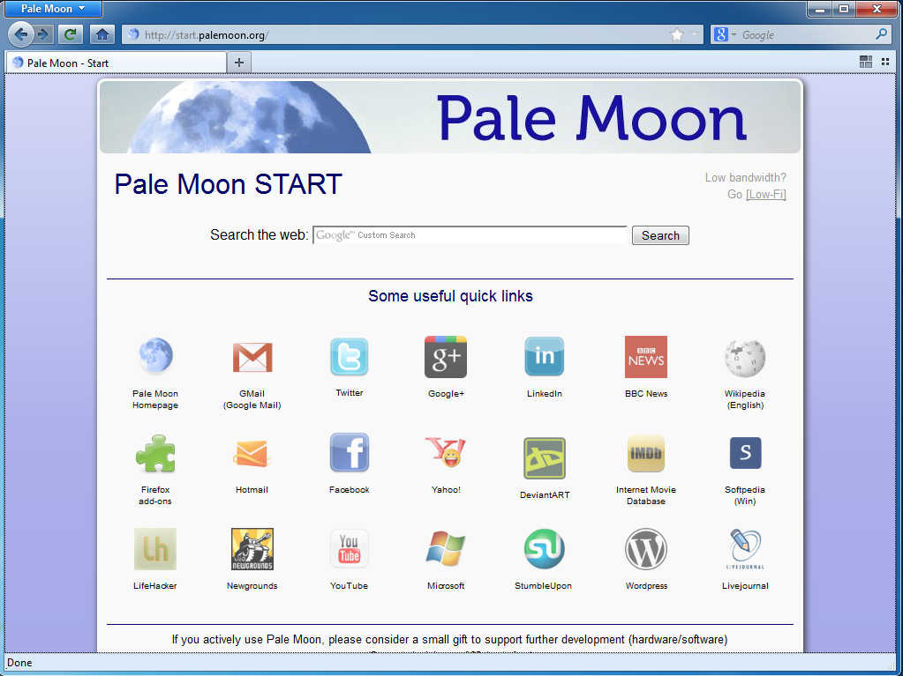
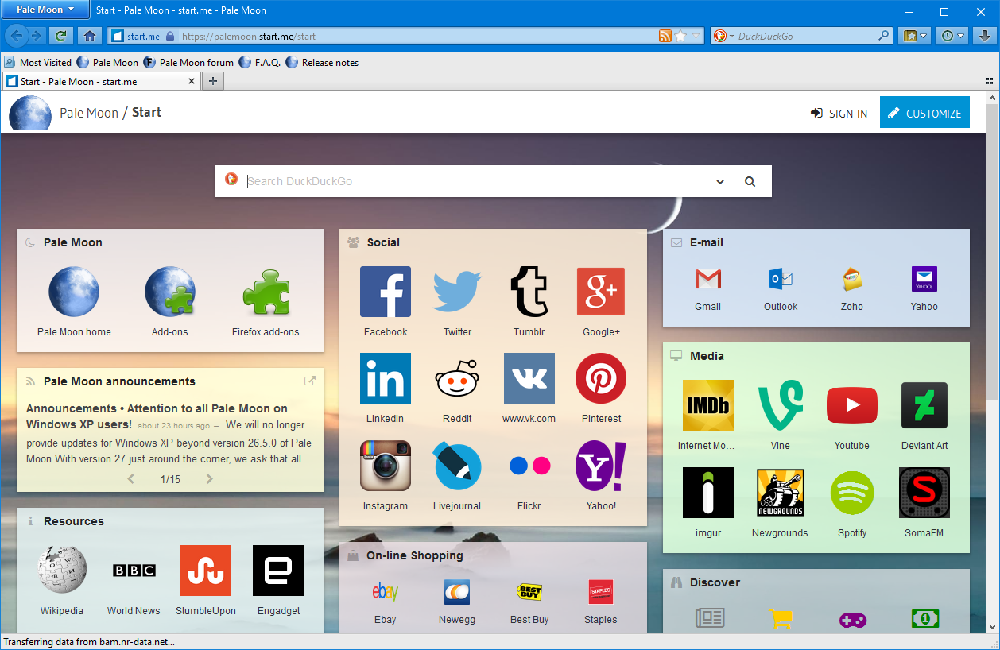

# Pale Moon Privacy Focused Customizable Browser

Pale Moon is a free browser built for user choice, familiar controls, and efficient browsing.
It keeps a customizable desktop interface while maintaining its own actively developed platform.

[](https://github.com/pale-moon-privacy/pale-moon/releases/)

## Objectives

Pale Moon aims to give people control over how they browse and which tools they use.
The project is community-driven and led by Moonchild Productions.

Its design balances a broad customization surface with a focused set of browser features.
The result is a browser with its own release plan and codebase, rather than a current Mozilla build.

## Feature Overview

| Area | Pale Moon capability | What to consider |
| --- | --- | --- |
| Rendering | Goanna platform and layout engine | Web compatibility depends on the engine |
| Interface | Traditional browser controls | Many navigation elements remain configurable |
| Extensions | Legacy Firefox extensions and Pale Moon add-ons | Compatibility is not guaranteed for every legacy add-on |
| Themes | Personas and complete themes | Theme support follows the Pale Moon platform |
| Media | JPEG-XL, JPEG, PNG, WebP, GIF, SVG, and Canvas | Format support is version and build dependent |
| Networking | Security-focused networking choices | Some newer protocols are intentionally not used |
| Recovery | Safe mode and recovery options | Use recovery tools when a profile behaves unexpectedly |



### Customization

The Pale Moon web browser keeps a traditional interface with configurable navigation controls.
Users can adapt the toolbar and tab strip to match their working habits.

The browser supports Personas and complete themes.
Extensions can add features through the platform's available extension APIs.

Legacy Firefox extensions may work when they target compatible platform behavior.
Pale Moon is not Firefox, so each extension should be checked before it becomes part of a regular workflow.

### Web Platform

Pale Moon uses the Goanna engine, an independent platform derived from older Mozilla code.
The project maintains its own code and release schedule.

The technical feature set includes HTML5, CSS3, DOM capabilities, SVG, Canvas, and downloadable CSS fonts.
Supported sites can still vary because web applications often target a different browser baseline.

## Privacy and Control

Pale Moon is designed around user control rather than mandatory account services.
The project does not describe the browser as a cloud account client.

Review the browser's privacy and content settings before using it for sensitive work.
A browser's privacy behavior also depends on extensions, sites, network services, and operating-system settings.

### A Careful Browsing Profile

1. Create a profile for the task.
2. Review extensions before enabling them.
3. Check site permissions and stored data.
4. Keep experimental add-ons separate from daily browsing.
5. Reopen the profile after changes to verify the result.

This workflow separates configuration experiments from regular browsing data.
It does not provide anonymity or replace network-level security controls.

## Built-In Web Features

Pale Moon retains native support for RSS and Atom feeds.
It also retains support for FTP and XSLT according to the project brief.

The browser can display common image formats and web graphics.
JPEG-XL support is included among the project's documented features.

- Use the feed tools for sources that publish compatible RSS or Atom data.
- Treat legacy protocols as compatibility features, not as a security guarantee.
- Check the page content when a modern site does not render as expected.
- Keep a backup of important profile data before changing add-ons.



## Add-ons and Themes

The Pale Moon add-ons ecosystem includes extensions, themes, search plugins, and language packs.
Community-maintained add-ons can extend the browser without changing the core application.

### Extension Review

| Before enabling | Review question |
| --- | --- |
| Extension source | Do you know who maintains it? |
| Permissions | Does it need access to every page? |
| Compatibility | Does it target Pale Moon or a compatible legacy API? |
| Maintenance | Is there a recent update or support discussion? |
| Recovery | Can you remove it from a separate test profile? |

Use a separate profile when evaluating an unfamiliar extension.
A clean test profile makes it easier to identify whether an add-on caused a problem.

## Portability and Platforms

Official Pale Moon builds are provided for supported Windows and Linux systems.
The project also documents builds and availability for additional Unix-like platforms.

Portable builds can keep browser data beside the application.
Portable operation is useful when a profile must travel with a controlled application copy.

Do not treat a portable profile as a backup.
Copy important data using a separate backup process and close the browser before copying active files.

### Platform Checks

- Confirm the processor and operating system requirements.
- Use the build intended for the platform.
- Keep the browser and profile on a writable local path.
- Check extensions after moving between operating systems.
- Review the release notes before upgrading a production profile.

## Source and Build Design

Pale Moon source is hosted on the project's repository server.
The browser uses the Unified XUL Platform as its underlying platform.

The source page advises users to understand the mixed licensing that applies to the repositories.
A build from source can therefore require more care than installing a project-supplied binary.

### Linux Build Prerequisites

The current Linux instructions list a C or C++ compiler, Python 3, Yasm, XZ, development packages, and free disk space.
They also recommend at least 6 GB of free RAM, depending on the number of processor cores.

| Requirement | Documented guidance |
| --- | --- |
| Python | Python 3.x, tested across several versions |
| Yasm | 1.2.0 or newer |
| Nasm | 2.14 or newer when building AV1 support with Dav1d |
| GCC | 11.x recommended; newer supported versions listed |
| RAM | At least 6 GB free, adjusted with build flags |
| Source path | Avoid spaces in the source path |

### Get the Source

The official Linux instructions use Git and update the platform submodule.
Run this from a directory selected for the source checkout.

```bash
git clone PALE_MOON_SOURCE_URL ./palemoon-source
cd palemoon-source
git submodule init
git submodule update
git checkout release
git submodule update
```

The commands select the release branch after initializing the required submodule.
Use the project's current developer documentation when branch names or build requirements change.

### Limit Parallel Work

Pale Moon builds can use substantial memory.
The developer documentation shows a make flag for limiting parallel jobs.

```text
mk_add_options MOZ_MAKE_FLAGS="-jN"
```

Replace N with a parallelism level suitable for the available memory.
A smaller value can reduce pressure on a system during compilation.

## Release and Security Notes

The current stable release is v35.0.3.
It is identified by the project as a security release dated October 27, 2026.

The release updated SQLite, removed compromised eMudhra certificates, fixed potential crashes, and addressed JavaScript and JAR-loading issues.
Review the complete release notes before updating an important profile.

## Community and Contributions

Pale Moon is built by a community of contributors.
The project welcomes feedback, testing, add-on work, translations, and source contributions.

When reporting a problem, include the browser version, operating system, profile state, and reproducible steps.
A test profile can help distinguish an extension issue from a browser issue.

## License and Project Identity

Pale Moon is free and open-source software with project-specific licensing terms.
Review the current licensing and redistribution conditions before creating a branded build.

The project is owned and led by M.C. Straver BASc.
Moonchild Productions is identified as the project organization.

## Related Search Terms

pale moon browser, pale moon web browser, pale moon linux, pale moon privacy browser, pale moon lightweight browser, browser, privacy, lightweight, firefox, linux, windows, macos, goanna, xul, extensions
